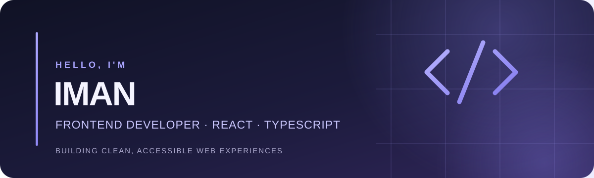

# Iman Rashidi

### Frontend Developer · Open-Source Contributor

React · TypeScript · JavaScript · Accessible UI · Developer Tools

Building responsive web applications and contributing to practical developer tools. Interested in clean, maintainable code, automated testing, AI memory evaluation, and software supply-chain security.

---

## Featured Projects

### [agent-memory-eval](https://github.com/Iman-Rashidi/agent-memory-eval)

A lightweight Python toolkit for evaluating ranked retrieval from AI agent memory systems.

- Recall@k, Precision@k, reciprocal rank, and binary/graded NDCG
- JSONL dataset validation and command-line evaluation
- Deterministic metrics with unit tests and GitHub Actions CI

### [CodeVault](https://github.com/CodeVault-Community/CodeVault)

A local-first code snippet manager built with React, TypeScript, and Vite.

- Create, search, filter, and organize reusable snippets
- Import and export JSON backups
- Responsive interface, automated tests, and GitHub Actions deployment

[Explore the live demo](https://CodeVault-Community.github.io/CodeVault/)

---

## Open-Source Contributions

I contribute focused fixes, tests, and documentation. The status below distinguishes merged work from pull requests that are still under review.

| Project | Contribution | Status |
| --- | --- | --- |
| [Kunji](https://github.com/testwithsuraj/kunji) | [PR #83](https://github.com/testwithsuraj/kunji/pull/83): regression tests for daily-budget thresholds and edge cases | **Merged** |
| [Kunji](https://github.com/testwithsuraj/kunji) | [PR #64](https://github.com/testwithsuraj/kunji/pull/64): verified Gemini and Groq model pricing | **Merged** |
| [Releaseproof](https://github.com/ujjwalv01/releaseproof) | [PR #140](https://github.com/ujjwalv01/releaseproof/pull/140): documentation for reproducing checks with a pinned Docker image | **Merged** |
| [CodeVault](https://github.com/CodeVault-Community/CodeVault) | [PR #1](https://github.com/CodeVault-Community/CodeVault/pull/1): contribution guidelines and issue/PR templates | **Merged** |
| [Releaseproof](https://github.com/ujjwalv01/releaseproof) | [PR #169](https://github.com/ujjwalv01/releaseproof/pull/169): documentation for a Rekor-certified staged release check | **Open** |
| [CodeVault](https://github.com/CodeVault-Community/CodeVault) | [PR #2](https://github.com/CodeVault-Community/CodeVault/pull/2): canonical repository links in the contribution guide | **Open** |

---

## Technologies & Interests

**Frontend:** React, TypeScript, JavaScript, HTML, CSS, Vite

**Testing & tooling:** Git, GitHub Actions, Python testing, pytest, Ruff

**Areas of interest:** Accessible interfaces, developer experience, AI agent memory evaluation, and software supply-chain security

---

## GitHub Skills

Completed hands-on GitHub Skills exercises:

- [Introduction to GitHub](https://github.com/Iman-Rashidi/skills-introduction-to-github-2)
- [Communicate using Markdown](https://github.com/Iman-Rashidi/skills-communicate-using-markdown)
- [Review Pull Requests](https://github.com/Iman-Rashidi/skills-review-pull-requests)
- [Hello GitHub Actions](https://github.com/Iman-Rashidi/skills-hello-github-actions)
- [Introduction to Git](https://github.com/Iman-Rashidi/Introduction-to-Git-skills-introduction-to-git)
- [Resolve Merge Conflicts](https://github.com/Iman-Rashidi/skills-resolve-merge-conflicts)

---

## Collaboration

I welcome constructive feedback, thoughtful code reviews, and collaboration on useful open-source projects.

*Build thoughtfully. Learn continuously. Improve every day.*
